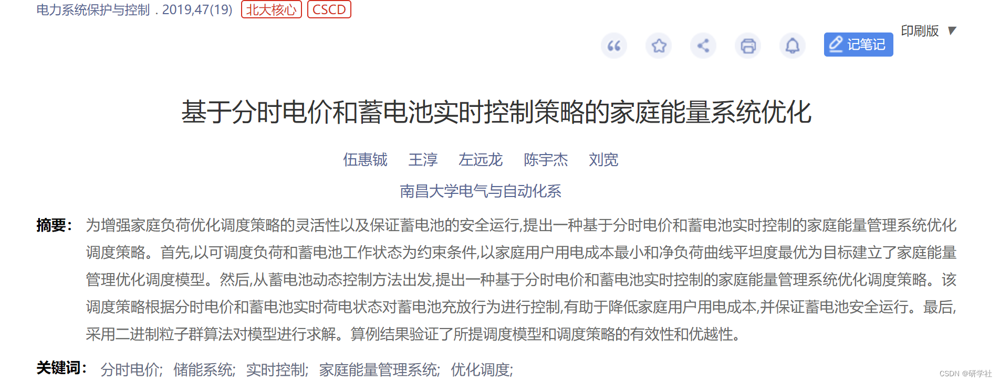
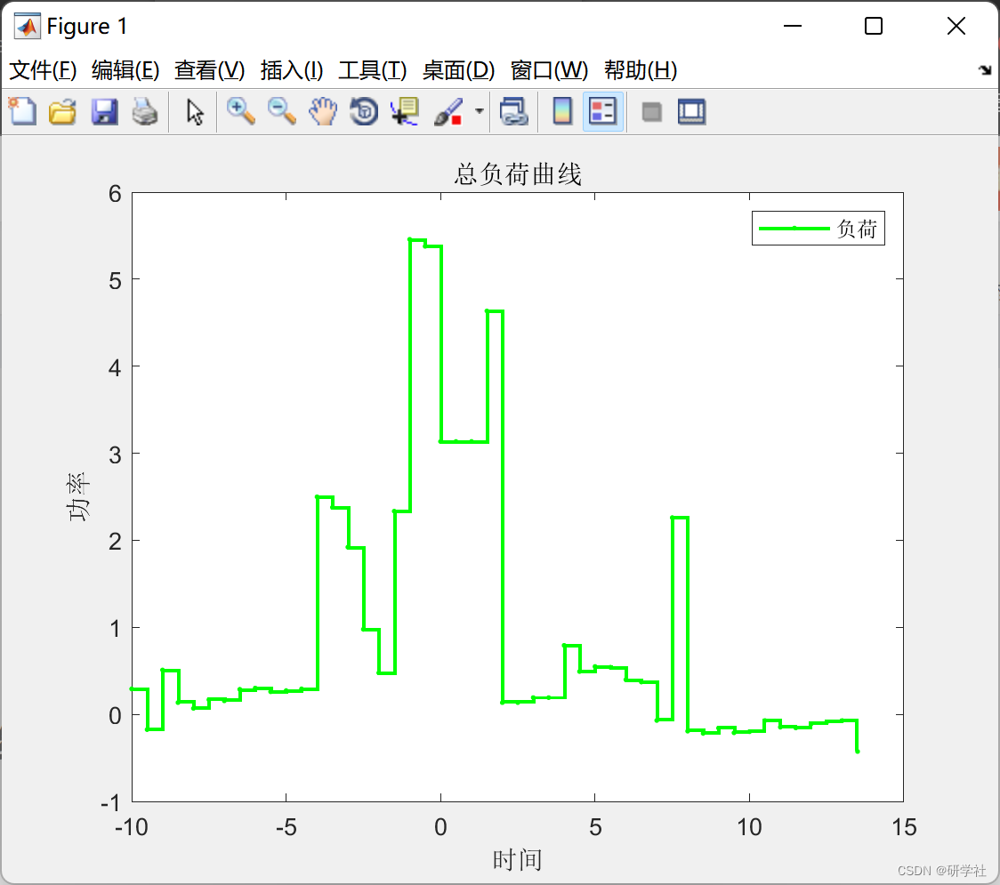
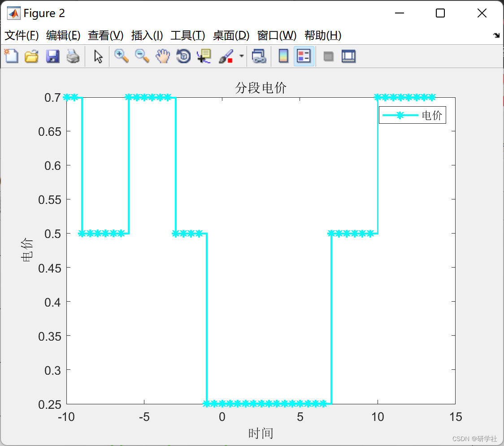
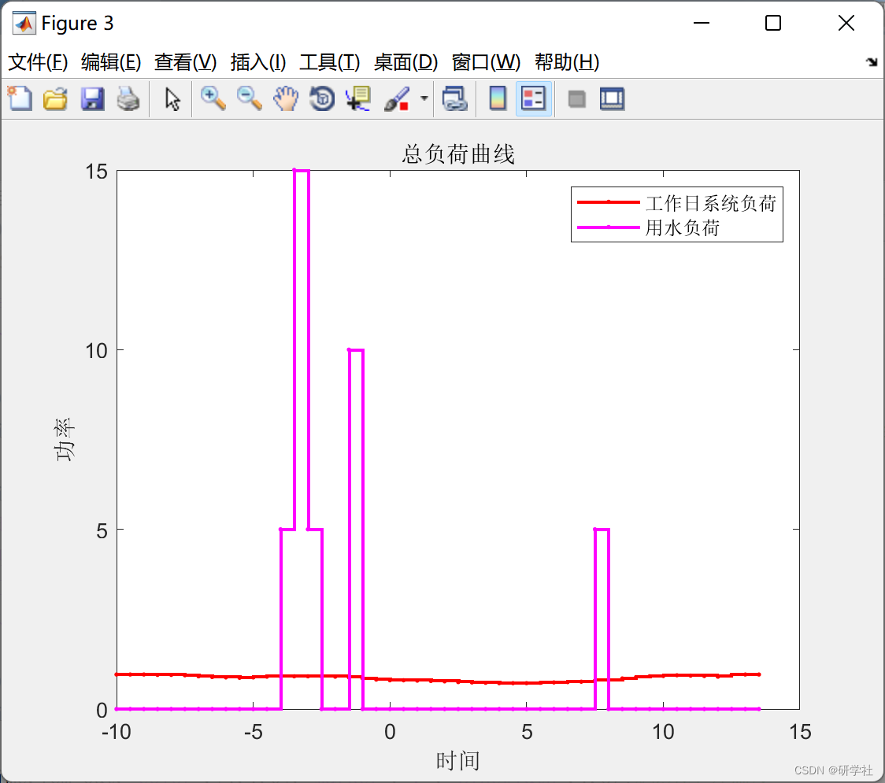
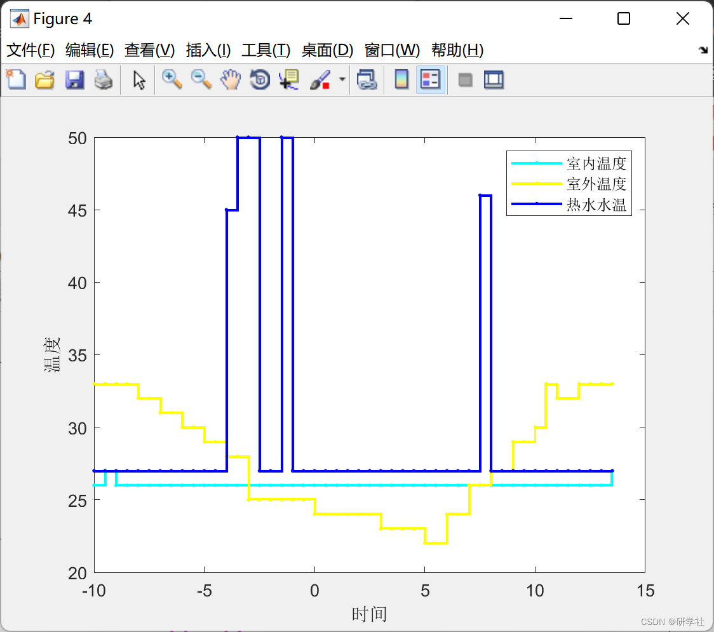
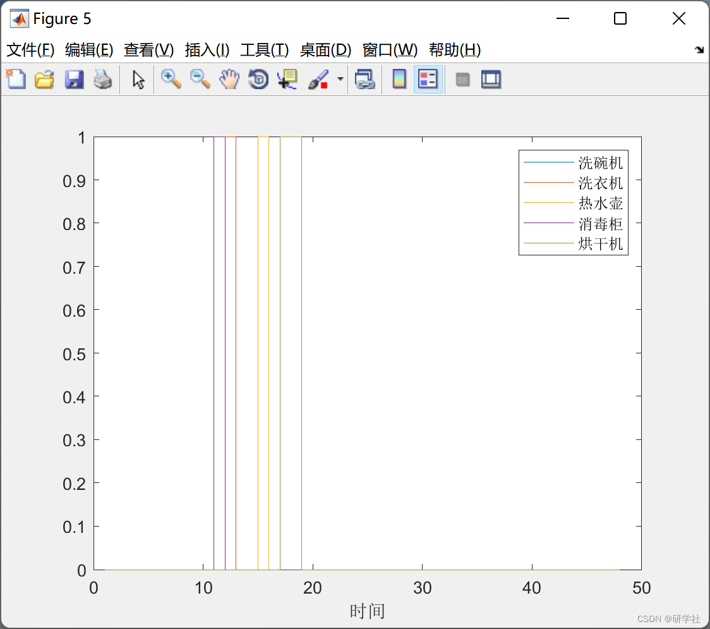
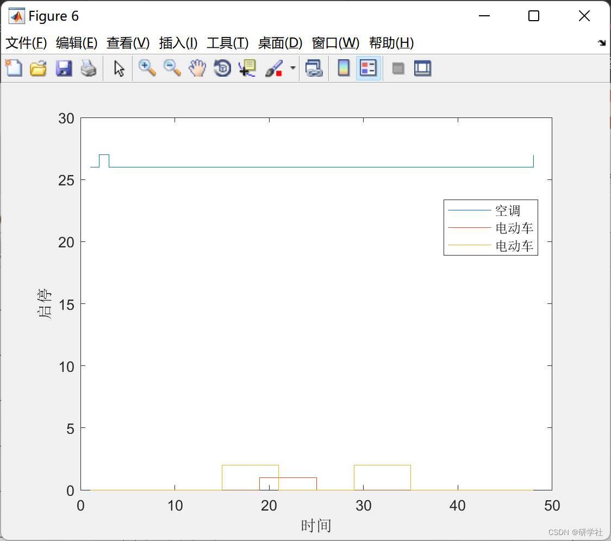

# Optimization of Home Energy System Based on Time-of-Use Pricing Strategy (Matlab Code Implementation)

💥💥💞💞 Welcome to this blog❤️❤️💥💥
🏆 Bloggers' Advantage: 🌞🌞🌞 The content of the blog strives to be rigorous in thought and clear in logic, for the convenience of readers.
⛳️ Mantra: "Those who travel a hundred miles may arrive at the ninety-ninth mile." 📜
💥1 Overview of References:
Editor
Currently, domestic and international scholars have conducted research on the optimization dispatch of household loads based on a home energy management system from different perspectives such as household load classification, optimization dispatch models, and solving algorithms. However, there are still many issues to be addressed in achieving optimized dispatch of household loads at this stage. Time-of-use or real-time electricity prices can reflect the temporal price difference of electrical energy products, which can better encourage users to plan their electricity usage more reasonably. However, under the environment of time-of-use or real-time electricity pricing, there are problems with too many decision variables and complex scheduling models for the optimal operation of household loads. Meanwhile, as photovoltaic, wind power, and other distributed generation systems and energy storage systems gradually integrate into household users, the user's electricity consumption structure is shifting towards microgrids with self-dispatching capabilities. How to achieve coordinated optimization between time-varying electricity prices, distributed generation systems, and energy storage systems and household loads remains to be studied. Literature comprehensively considers the coordination of various types of equipment and distributed new energy sources, establishing an optimization decision model for household equipment under multiple pricing mechanisms. Literature aims to reduce the electricity cost for users and minimize fluctuations in the distribution network side load by establishing a smart community energy management system model that takes into account distributed power sources, energy storage systems, and controllable loads. Literature has established a multi-timescale home energy management model based on model predictive control, adjusting the charging and discharging power of batteries to cope with unscheduled loads and fluctuations in photovoltaic output during real-time operations, ensuring that the user's purchased electricity meets demand response requirements.
This article mainly focuses on the family energy management model. Firstly, it constructs energy management models for several household electrical appliances such as electric vehicles, air conditioners, water heaters, and dryers. Secondly, it considers the optimal energy management strategies for household users during peak and off-peak electricity prices, dynamic electricity pricing, and weekends versus weekdays. These strategies are optimized through CPLEX in different scenarios, suitable for beginners to learn from and further expand upon.
📚2 Running Results Edit
​Edit
​Edit
​Edit
​Edit
Part of the code:
% Hot Water Bottle Constraints
C = [C, sum(shui_hu) == 1, sum(shui_hu(1,15:34)) == 1];
C = [C, sum(y_tj) == 1, sum(y_tj(1,15:34)) == 1];
for i = 1:n
shui_hu(1,i) = y_tj(1,i);
end
% Dishwasher Constraints
C = [C, sum(xi_wan) == 2, sum(xi_wan(1,13:24)) == 2];
C = [C, sum(y_dwm) == 1, sum(y_dwm(1,13:23)) == 1];
xi_wan(1,1) = 0;
for i = 2:n
xi_wan(1,i) = y_dwm(1,i-1) + y_dwm(1,i);
end
% Disinfection Cabinet Constraints
C = [C, sum(xiao_du) == 1, sum(xiao_du(1,11:34)) == 1];
C = [C, sum(y_dfc) == 1, sum(y_dfc(1,11:34)) == 1];
for i = 1:n
xiao_du(1,i) = y_dfc(1,i);  
end  
% Dryer Constraints
C = [C,sum(hong_gan) == 2,sum(hong_gan(1,17:34)) == 2];  
C = [C,sum(y_dy) == 1,sum(y_dy(1,17:33)) == 1];  
hong_gan(1,1) = 0;  
for i = 2:n  
hong_gan(1,i) = y_dy(1,i-1) + y_dy(1,i);  
end  
% Electric Vehicle Constraints
C = [C,sum(qi_he) == 6,sum(qi_he(1,9:32)) == 6];  
% Computer Constraints
for i = 1:n  
C = [C,0<=dian_nao(1,i)<=2];  
end  
C = [C,12 <= sum(dian_nao) <= 24,12 <= sum(dian_nao(1,9:20)) <= 24];  
% Air Conditioning Constraints
for i = 1:n  
C = [C,25<=kong_tiao(1,i)<=27];  
if i == 1  
C = [C,abs(((kong_tiao(1,i)-27*exp(-0.5/(0.57*6)))/(1-exp(-0.5/(0.57*6)))-Tem_Out(1,i))/(2.9*6))<=2];  
else  
C = [C,abs(((kong_tiao(1,i)-kong_tiao(1,i-1)*exp(-0.5/(0.57*6)))/(1-exp(-0.5/(0.57*6)))-Tem_Out(1,i))/(2.9*6))<=2];  
end  
end  
🎉3 References [1] Wu Huicheng, Wang Chun, Zuo Yuanlong, Chen Yujie, Liu Kuan. Optimization of Home Energy Systems Based on Time-of-Use Pricing and Real-Time Battery Control Strategy [J]. Power System Protection and Control, 2019, 47(19): 23-30. DOI: 10.19783/j.cnki.pspc.181396.
🌈4 Matlab code implementation

## Images

<!-- PAYMENT_BLOCK -->

## Get this dataset

- Payment link (Stripe): [Buy now](https://buy.stripe.com/3cs8yP7sY87d0vu9AB)
- Payment QR code: 

<!-- /PAYMENT_BLOCK -->
